# CAREERPIVOT AI – Intelligent Career Transition and Job Readiness Coach

CAREERPIVOT AI is a hackathon-ready, full-stack career coaching platform that guides students and professionals through career pivots into modern tech roles. Powered by reproducible machine learning pipelines, relational SQLite persistence, and a dark navy SaaS user experience.

---

## 1. System Architecture

```mermaid
flowchart LR
    subgraph Frontend["Next.js App Router (Port 3000)"]
        UI_Home["Landing / Overview"]
        UI_Dash["Dashboard"]
        UI_Resume["Resume Analyzer"]
        UI_Career["Career Selection"]
        UI_Gap["Skill Gap Matrix"]
        UI_Roadmap["Adaptive Roadmap"]
        UI_Projects["Portfolio Projects"]
        UI_Interview["Mock Interview Arena"]
        UI_Apps["Job Application Tracker"]
    end

    subgraph Backend["FastAPI ML Engine (Port 8000)"]
        M1["Model 1: Skill Classifier (Joblib)"]
        M2["Model 2: TF-IDF Job Matcher (Joblib)"]
        M3["Model 3: Interview Rubric Evaluator (Joblib)"]
        Parser["Document Extraction (PyMuPDF & python-docx)"]
    end

    subgraph Storage["SQLite Relational DB"]
        DB[(careerpivot.db)]
    end

    Frontend -->|REST APIs| Backend
    Backend --> Storage
```



---

## 2. Machine Learning Pipelines (Zero Paid APIs)

All models are trained with reproducible Python scripts and saved to `ml-service/models/`:

### Model 1: Resume Skill Categorization Classifier
- **Algorithm:** Supervised character/word n-gram `TfidfVectorizer` + multinomial `LogisticRegression`.
- **Taxonomies (8 Domains):** `frontend`, `backend`, `database`, `cloud`, `programming`, `soft_skills`, `data_ml`, `security`.
- **Accuracy:** $100.0\%$ test accuracy on 108 held-out stratified test samples.
- **Artifact:** `ml-service/models/skill_classifier_pipeline.joblib`

### Model 2: TF-IDF Job Matching & Ranking Engine
- **Algorithm:** Blended TF-IDF Cosine Similarity ($25\%$) + Weighted Direct Skill Overlap ($75\%$).
- **Correlation:** Pearson $r = 0.9733$, Spearman $\rho = 0.9701$ on benchmark test pairs.
- **Outputs:** Job match score ($0-100\%$), missing skills prioritized by importance, and transparent suitability narrative.
- **Artifact:** `ml-service/models/job_matching_vectorizer.joblib`

### Model 3: Mock Interview Quality & Rubric Evaluator
- **Algorithm:** TF-IDF n-gram vectorizer + multinomial logistic regression for 4 quality tiers (`exemplary`, `proficient`, `developing`, `insufficient`).
- **Scoring Rubric:** Technical concept coverage, topical relevance, and structural clarity.
- **Validation:** 4-Fold Stratified Cross-Validation Accuracy: $87.50\% \pm 12.50\%$.
- **Artifact:** `ml-service/models/interview_evaluator.joblib`

---

## 3. Technology Stack

- **Frontend:** Next.js 14 (App Router), React 18, TypeScript, Tailwind CSS, Lucide React, Recharts.
- **Backend:** Python 3.12, FastAPI, Uvicorn, SQLite3, Pydantic v2.
- **Machine Learning & NLP:** Scikit-Learn, Pandas, NumPy, Joblib, PyMuPDF (`fitz`), `python-docx`.
- **Database:** Normalized SQLite schema with 13 tables, foreign key constraints, and seed data.

---

## 4. Setup & Running Instructions

### Step 1: Clone & Navigate to Workspace
```powershell
cd C:\Users\SHUBHAM\.gemini\antigravity\scratch\CareerPivotAI
```

### Step 2: Prepare Datasets & Train Machine Learning Models
```powershell
cd ml-service
python training/prepare_dataset.py
python training/train_skill_model.py
python training/train_matching_model.py
python training/train_interview_model.py
python training/evaluate_models.py
cd ..
```

### Step 3: Start the FastAPI Backend (Port 8000)
```powershell
cd ml-service
python -m uvicorn app.main:app --host 127.0.0.1 --port 8000 --reload
```
API Documentation will be live at: `http://127.0.0.1:8000/docs`

### Step 4: Start the Next.js Frontend (Port 3000)
Open a new terminal window:
```powershell
cd C:\Users\SHUBHAM\.gemini\antigravity\scratch\CareerPivotAI\frontend
npm run dev
```
Open `http://localhost:3000` in your web browser.

---

## 5. Complete User Journey & Working Workflow

The platform provides an end-to-end guided career development journey:

```
Registration & Profile → Resume Upload & Analysis → Career Selection → Skill Gap Matrix → Learning Roadmap → Portfolio Projects → Mock Interview → Job Tracking → Progress Dashboard → Updated Recommendations
```

1. **User Registration & Profile Creation (`/profile`):**
   - User creates an account by entering their name, email, education, current skills, years of experience, and career interests.
   - Synchronized to SQLite database and establishes baseline profile metrics.

2. **Resume Upload & Analysis (`/resume`):**
   - Upload PDF, DOCX, or paste text.
   - Parses education, work history, projects, and extracts skills using Model 1 (`skill_classifier_pipeline.joblib`) across 8 domains.
   - Allows manual skill additions and deletions with real-time category updates.

3. **Target Career Selection (`/career`):**
   - 9 built-in high-demand tech pathways (Frontend, Backend, Full Stack, Data Science, ML Engineer, Cloud, Security, etc.) + custom job role builder.
   - Real-time salary ranges, demand ratings, and core skill requirements.

4. **AI-Powered Skill Gap Analysis (`/skill-gap`):**
   - Model 2 TF-IDF Cosine Similarity engine compares candidate profile against job specifications.
   - Calculates match score ($0-100\%$) and skill gap percentage.
   - Interactive Recharts Radar Chart visualizing domain balances.
   - Prioritized missing skill gaps (Essential, Important, Nice-to-have) with action steps.

5. **Personalized Learning Roadmap (`/roadmap`):**
   - 8-week structured transition curriculum.
   - Weekly tasks, practice activities, project deliverables, and resource links.
   - Checkbox tracking with automated progress recalculation.

6. **Portfolio Project Recommendations (`/projects`):**
   - Curated architectural projects targeting specific skill gaps.
   - Filter by pathway and difficulty (Beginner, Intermediate, Advanced) with full technical specifications.

7. **AI-Powered Mock Interview (`/interview`):**
   - Select target role and difficulty (Junior, Mid-level, Senior).
   - Type structured answers; evaluated honestly by Model 3 without fake biometric claims.
   - Displays sub-scores (Relevance, Coverage, Structure), concept coverage tags, and targeted improvement suggestions.

8. **Job Application Tracker (`/applications`):**
   - Manage application pipelines (Wishlist, Applied, Screening, Technical Interview, Final Round, Offer, Rejected).
   - Real funnel conversion analytics (Interview rate, offer rate, timeline).

9. **Personalized Dashboard (`/dashboard`):**
   - Unified overview of match score gauge, skills verified vs gaps, roadmap completion, interview average, application funnel, and prioritized next steps.

10. **Updated Recommendations & Iterative Feedback:**
    - As the user completes roadmap milestones, finishes projects, and passes mock interviews, recommendation weights automatically adjust toward job application readiness.
