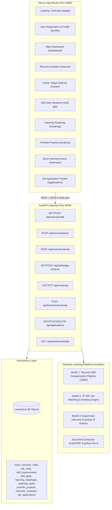

# CareerPivot AI — System Architecture & Design

## 1. High-Level Architecture Overview

CareerPivot AI is designed as a modular, production-ready career transition and job readiness coach. It integrates a responsive Next.js frontend with an explainable Python FastAPI machine learning backend and a normalized SQLite relational database.



## 2. Core Service Components

### 2.1 Backend Services (`ml-service/app/`)
1. **`main.py`**: FastAPI application exposing CORS-enabled REST endpoints, database lifecycle management, and global error handling.
2. **`resume_parser.py`**: Multi-format document parser supporting PDF (PyMuPDF/fitz), DOCX (python-docx), and plain text. Implements regex and heuristic section segmenters (Experience, Education, Skills, Projects).
3. **`skill_extractor.py`**: Hybrid skill detection combining dictionary phrase matching with the Model 1 supervised classifier (`skill_classifier_pipeline.joblib`) to categorize extracted skills into domains.
4. **`job_matcher.py`**: Implements Model 2 TF-IDF cosine similarity, requirement overlap calculation, gap percentages, and dynamic role suitability narratives.
5. **`interview_evaluator.py`**: Implements Model 3 answer evaluation, computing relevance score, technical coverage, structural quality, concept detection, and personalized feedback.
6. **`schemas.py`**: Strict Pydantic models for request validation and response typing.

### 2.2 Relational Database Schema (`database/`)
- Fully normalized SQLite schema with foreign key constraints, cascaded deletes, and indexed query paths.
- Default pre-seeded catalog with 9 target tech roles, 35+ industry skills, portfolio project templates, and realistic mock interview questions.

### 2.3 Frontend Application (`frontend/src/app/`)
- Built with Next.js 14 App Router, TypeScript, Tailwind CSS, Lucide React, and Recharts.
- Dark navy SaaS design system with blue/indigo/purple glowing gradients, glassmorphism card surfaces, and accessible typography.

## 3. Complete 10-Step User Journey & Technical Working

```
Registration & Profile → Resume Upload & Analysis → Career Selection → Skill Gap Matrix → Learning Roadmap → Portfolio Projects → Mock Interview → Job Tracking → Progress Dashboard → Updated Recommendations
```

1. **User Registration & Profile Creation (`/profile`):**
   - User creates an account by entering name, email, education, current skills, years of experience, and target career interests.
   - Synchronized to SQLite `users` table and initializes baseline profile metrics.
2. **Resume Upload and Analysis (`/resume`):**
   - Extracts resume content from PDF (PyMuPDF) or DOCX (python-docx).
   - Segments education, experience, and projects.
   - Categorizes skills across 8 domains using Model 1 (`skill_classifier_pipeline.joblib`).
   - Allows candidate manual corrections and saves to database.
3. **Target Career Selection (`/career`):**
   - Candidate selects from 9 standard roles (Frontend, Backend, Full Stack, Data Science, ML Engineer, Cloud, Security, etc.) or creates a custom role.
   - Loads verified role requirements from the database.
4. **AI-Powered Skill Gap Analysis (`/skill-gap`):**
   - Model 2 TF-IDF Cosine Similarity engine calculates readiness match score ($0-100\%$) and skill gap percentage.
   - Displays interactive Recharts Radar Chart for domain balance and prioritizes missing skills (Essential, Important, Nice-to-have).
5. **Personalized Learning Roadmap (`/roadmap`):**
   - Generates an 8-week structured transition curriculum.
   - Includes weekly topics, practical exercises, deliverables, and resource links.
   - As tasks are completed, the system dynamically recalculates progress.
6. **Portfolio Project Recommendations (`/projects`):**
   - Suggests production-grade projects specifically designed to bridge the user's missing skills.
   - Provides architecture specifications, suggested features, and deliverables.
7. **AI-Powered Mock Interview (`/interview`):**
   - Generates relevant technical questions for the selected role and difficulty (Junior, Mid, Senior).
   - Evaluates typed answers with Model 3 supervised classifier and explainable rubrics: technical coverage, relevance, structure, and missing concepts.
8. **Job Application Tracker (`/applications`):**
   - Logs company, title, stage (Wishlist, Applied, Screening, Technical Interview, Final Round, Offer, Rejected), and interview dates.
   - Computes statistical conversion rates and response performance.
9. **Personalized Progress Dashboard (`/dashboard`):**
   - Unified overview of match score gauge, skills verified vs gaps, roadmap completion, interview average, application funnel, and prioritized next steps.
10. **Updated Recommendations & Iterative Feedback:**
    - As the user completes roadmap milestones, finishes projects, and passes mock interviews, recommendation weights automatically adjust toward job application readiness.

